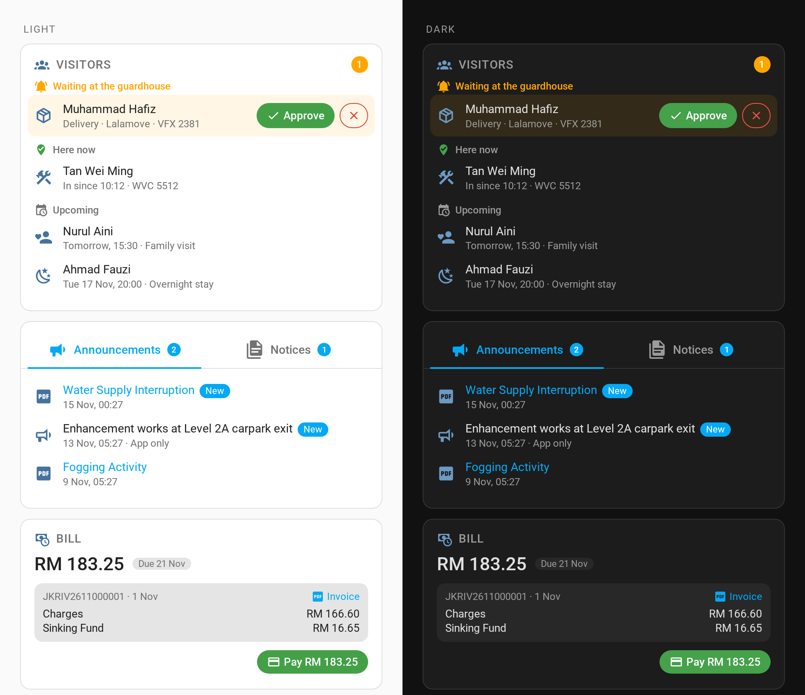

[](https://github.com/hacs/default)
[](https://github.com/hacs/integration)

[](https://zubirco.de/buymecoffee)


A Home Assistant custom integration for the [SPFM Selfcare portal](https://spfm.com.my/prod/session/selfcare/login)
(Sunway Property Facility Management). It shows your strata / maintenance billing for every unit linked to your login.

## Features

- **Unit auto-discovery**: one login finds every unit (and its development) linked to your account
- **Outstanding balance** and **next due date**
- **Last bill**: amount, date, invoice number and line items (service charge, sinking fund, insurance…)
- **Last payment**: amount, date and receipt number
- **Service charge** and **sinking fund**: latest monthly amounts, with billing period
- **Announcements**: latest notice with a link back to it in the portal and its PDF, plus a count of active notices
- **`spfm_new_announcement` event** whenever a new notice is posted, for notifications
- **Retry with backoff** for transient portal errors; automatic re-login when the token expires
- **Re-auth flow** if your password changes; options flow to choose units

## Installation

### HACS (custom repository)

1. HACS → **Integrations** → ⋮ → **Custom repositories**
2. Add this repository's URL, category **Integration**
3. Install **SPFM**, then restart Home Assistant

### Manual

Copy `custom_components/spfm/` into your Home Assistant `config/custom_components/` folder and restart.

## Configuration

**Settings → Devices & Services → Add Integration → SPFM**, then enter your SPFM email and password.
If more than one unit is linked, pick the ones to monitor.

## Sensors (per unit)

| Sensor | Unit | Notes |
| --- | --- | --- |
| Outstanding balance | MYR | `items` attribute lists unpaid lines |
| Next due date | date | earliest due date among unpaid items |
| Last bill amount | MYR | attrs: `reference_no`, `bill_date`, `due_date`, `items`, `invoices` (last 12) |
| Last bill date | date | |
| Last payment amount | MYR | attrs: `receipt_no`, `payments` (last 12) |
| Last payment date | date | |
| Service charge | MYR | latest `IVSC` charge, attr `period` |
| Sinking fund | MYR | latest `IVSF` charge, attr `period` |
| Latest announcement | text | title; attrs `url` (portal page), `pdf_url`, `attachments`, `published`, `start_date`, `end_date`, `active`, `summary`, `list_url` |
| Active announcements | count | notices not past their end date; attr `announcements` (id, title, published, url, pdf_url) |

Data refreshes hourly.

### Calendar: `calendar.<unit>_announcements`

Every notice is also an all-day event on a per-unit calendar (shown in HA's Calendar panel and the calendar card):

- Notices with an end date span start → end date (inclusive), so the calendar is **on** during e.g. a pool-maintenance window.
- Notices without one appear on the day they were published.
- The description holds the full notice text plus `PDF:` and `Portal:` links.

Notifications should still use the `spfm_new_announcement` event: notices are discovered by polling after they're published, and HA calendar triggers don't fire for events that already started.

### Event: `spfm_new_announcement`

Fired once per newly posted notice, and again when management re-sends an existing notice
(its `last_notification` time changes; `renotified: true`). Notified ids are stored in
`.storage/spfm.<entry_id>_announcements`, so a notice posted while HA was restarting still fires
on the next poll. The very first poll after installing only records what's already there.
Data: `unit_id`, `unit_no`, `project`, `id`, `title`, `url`, `published`, `summary`, `attachments`, `renotified`.

Debug: Developer Tools → Events → listen to `spfm_new_announcement`; the integration also logs
`SPFM new announcement …` at INFO level.

## Notifications & visitors (v0.4.0)

Polled every **2 minutes** from the same feeds the SPFM mobile app uses (found by reading the app's bundle):

| Feed | Endpoint |
|---|---|
| Notifications tab (what the app pushes) | `selfcare/selfcare-notification` (`user_id` = member id) |
| App announcement feed (incl. expired) | `selfcare/dashboard/announcement/` |
| Registered visitors | `selfcare/appointment/` |
| Walk-ins waiting for approval | `selfcare/appointment-guest-pending` |

Some notices are pushed but never appear in the web listing, so **`spfm_new_announcement` is now driven by the notification feed**.

### Entities
SPFM has two kinds of announcement. Since v0.6.0 each gets its own sensor:

| Sensor | What it is | State | List attribute |
|---|---|---|---|
| `sensor.<unit>_active_announcements` (name **Notices**) | official Sunway notices from the listings, usually with a PDF | active count | `announcements` |
| `sensor.<unit>_latest_announcement` | the app's bell: announcement pushes. Some point to a notice, some don't. | newest title | `announcements` |

Both lists use the same row keys: `id`, `title`, `published`, `active`, `url`, `pdf_url`. Announcement rows add `notice` (true when the push points to an official notice; the full title, text, dates and PDF are then taken from that notice). Push-only rows have `active: null`, `pdf_url: null`, and the push text as title (SPFM cuts it at about 60 characters). Re-sent pushes appear once. `latest_announcement` also has top-level `title`, `message`, `published`, `start_date`, `end_date`, `active`, `url`, `pdf_url`, `notice`.

Markdown card example:
```jinja

- **{{ a.title }}** · {{ as_timestamp(a.published) | timestamp_custom('%d %b') }} · [PDF]({{ a.pdf_url }})

```

- `sensor.<unit>_pending_visitors`: number of walk-ins waiting at the guardhouse; `visitors` lists them with `id`, `name`, `type`, `vehicle`, `company`.
- `sensor.<unit>_upcoming_visitors`: registered visits from today on; plus `next` and `recent`.
- `calendar.<unit>_visitors`: each registered visit as a timed event (1 h, or check-in to check-out once scanned).

### Events
| Event | When | Data |
|---|---|---|
| `spfm_notification` | any new push (announcement, owner manual, form, booking…) | `id`, `module`, `object_id`, `title`, `message`, `created`, `url` |
| `spfm_new_announcement` | push with module ANNOUNCEMENT | `id` (notice id), `notification_id`, `title`, `url`, `published`, `summary`, `attachments`, `renotified` |
| `spfm_visitor_pending` | a walk-in visitor/delivery is waiting for approval | `id`, `name`, `type`, `vehicle`, `company`, `image_url` … |
| `spfm_visitor_arrived` / `spfm_visitor_departed` | a registered visitor is scanned in / out | visitor fields incl. `scan_in` / `scan_out` |

All include `unit_id`, `unit_no`, `project`. Fired items are stored in `.storage/spfm.<entry_id>_activity`, so restarts neither replay nor drop them. The first poll after install just records what already exists.

### Services
`spfm.approve_visitor` / `spfm.reject_visitor` with `visitor_id` (and `unit_id` if you have several units). This is the same call as the app's Approve/Reject buttons.

```yaml
# Actionable phone alert for a walk-in visitor or delivery
alias: SPFM – visitor at guardhouse
mode: queued
trigger:
  - platform: event
    event_type: spfm_visitor_pending
action:
  - service: notify.mobile_app_your_phone
    data:
      title: "🚪 {{ trigger.event.data.type | default('Visitor') | title }} at guardhouse"
      message: "{{ trigger.event.data.name }} {{ '· ' ~ trigger.event.data.vehicle if trigger.event.data.vehicle }}"
      data:
        tag: "spfm-visitor-{{ trigger.event.data.id }}"
        actions:
          - action: "SPFM_APPROVE_{{ trigger.event.data.id }}"
            title: Approve
          - action: "SPFM_REJECT_{{ trigger.event.data.id }}"
            title: Reject
  - wait_for_trigger:
      - platform: event
        event_type: mobile_app_notification_action
    timeout: "00:10:00"
  - choose:
      - conditions: "{{ wait.trigger and wait.trigger.event.data.action == 'SPFM_APPROVE_' ~ trigger.event.data.id }}"
        sequence:
          - service: spfm.approve_visitor
            data: { visitor_id: "{{ trigger.event.data.id }}" }
      - conditions: "{{ wait.trigger and wait.trigger.event.data.action == 'SPFM_REJECT_' ~ trigger.event.data.id }}"
        sequence:
          - service: spfm.reject_visitor
            data: { visitor_id: "{{ trigger.event.data.id }}" }
```

### Example automations

Push a phone notification that opens the notice when tapped:

```yaml
automation:
  - alias: "SPFM new announcement"
    trigger:
      - platform: event
        event_type: spfm_new_announcement
    action:
      - service: notify.mobile_app_phone
        data:
          title: "{{ trigger.event.data.project | title }}"
          message: "{{ trigger.event.data.title }}"
          data:
            url: "{{ trigger.event.data.url }}"          # iOS
            clickAction: "{{ trigger.event.data.url }}"  # Android
            actions:
              - action: URI
                title: Open PDF
                uri: "{{ trigger.event.data.attachments[0].url if trigger.event.data.attachments else trigger.event.data.url }}"
```

Dashboard card listing recent notices as links:

```yaml
type: markdown
title: Building notices
content: >
  
  - [{{ a.title }}]({{ a.url }}) · [PDF]({{ a.pdf_url }}) <small>{{ a.published[:10] }}</small>
  
```

Bill reminder:

```yaml
automation:
  - alias: "SPFM bill outstanding"
    trigger:
      - platform: numeric_state
        entity_id: sensor.residensi_jernih_kajang_a_01_01_outstanding_balance
        above: 0
    action:
      - service: notify.mobile_app_phone
        data:
          message: >
            SPFM: RM{{ states('sensor.residensi_jernih_kajang_a_01_01_outstanding_balance') }}
            due {{ states('sensor.residensi_jernih_kajang_a_01_01_next_due_date') }}
```

## Bills (v0.8.0)

- `sensor.<unit>_outstanding_balance` now carries `bills` (unpaid documents grouped per bill: `reference_no`, `date`, `due`, `amount`, `items`, `pdf_path`) and `pay_url`.
- `pdf_path` is a Home Assistant path (`/api/spfm/document/<unit>/<BILL|RECEIPT|CN|DN>/<record_id>`). HA fetches the PDF from SPFM with your token, so the token never reaches the browser. It needs HA auth; the card signs the path for you.
- `pay_url` opens the portal's **Outstanding** page. SPFM pays through a signed iPay88/Razer request built in the portal, so a direct pay link isn't possible.

### Event: `spfm_new_bill`

Fired once per new invoice (the first poll after install only records existing bills). Data: `unit_id`, `unit_no`, `project`, `reference_no`, `date`, `due`, `amount`, `outstanding`, `items` (`item`, `period`, `amount`), `outstanding_balance`, `pdf_path`, `pay_url`. Bills are polled hourly.

```yaml
alias: SPFM - new bill
triggers:
  - trigger: event
    event_type: spfm_new_bill
actions:
  - action: notify.mobile_app_your_phone
    data:
      title: "New SPFM bill: RM{{ '%.2f' | format(trigger.event.data.amount) }}"
      message: >-
        {{ trigger.event.data.items | map(attribute='item') | map('title') | join(' + ') }},
        due {{ as_timestamp(trigger.event.data.due) | timestamp_custom('%-d %b') }}.
      data:
        url: "{{ trigger.event.data.pay_url }}"          # iOS
        clickAction: "{{ trigger.event.data.pay_url }}"  # Android
        actions:
          - action: URI
            title: Pay now
            uri: "{{ trigger.event.data.pay_url }}"
```

Due-date reminder (no event needed):

```yaml
alias: SPFM - bill due in 3 days
triggers:
  - trigger: time
    at: "09:00:00"
conditions:
  - condition: template
    value_template: >-
      
      {{ due not in ['unknown','unavailable','none']
         and (as_datetime(due).date() - now().date()).days == 3
         and states('sensor.residensi_jernih_kajang_a_10_01_outstanding_balance') | float(0) > 0 }}
actions:
  - action: notify.mobile_app_your_phone
    data:
      title: SPFM bill due in 3 days
      message: "RM{{ states('sensor.residensi_jernih_kajang_a_10_01_outstanding_balance') }} outstanding."
```

## Dashboard cards (v0.9.0)



The integration ships its own cards and loads them on every dashboard automatically: no HACS frontend install and no resource to add. Go to **Edit dashboard → Add card** and search for **SPFM**. There are three ready-made cards:

```yaml
type: custom:spfm-visitors-card   # walk-ins to approve, here now, upcoming
---
type: custom:spfm-updates-card    # Announcements and Notices as two tabs
---
type: custom:spfm-bill-card       # amount, due date, invoice PDF, Pay
```

Each takes `device` (optional; defaults to the first unit), `max_items` (5), `this_month` (false) and `title` (empty by default; set it to show the unit name with the SPFM mark when you have more than one unit).

There's also an all-in-one card with every section, as tabs (default) or stacked:

```yaml
type: custom:spfm-card
device: <your SPFM unit device>     # optional
layout: tabs                         # or: stacked
default_tab: visitors                # tab to open first
sections: [visitors, announcements, notices, bill]   # order = tab order
max_items: 5
this_month: false
title: My unit                       # optional; "" hides the header
```

Tab badges show what needs attention: walk-ins waiting (orange), announcements and notices from the last 3 days (blue), and a dot on Bill when something is unpaid (red once overdue).

- **Visitors**: walk-ins waiting at the guardhouse appear on top with **Approve** / **Reject** buttons (they call `spfm.approve_visitor` / `spfm.reject_visitor`), then *Here now* and *Upcoming*, with an icon for each visitor type.
- **Announcements**: the app's bell feed. A row links to its PDF when there is one, otherwise to the notice page when it points at one, otherwise it's plain text marked *App only*.
- **Notices**: active official notices with their PDFs, plus a link to the full list.
- **Bill**: outstanding balance and due date, each unpaid bill's line items with an **Invoice** PDF button, and a **Pay** button that opens SPFM's Outstanding page. *All paid up* when nothing is owed.

Tapping a section header (stacked cards) opens that sensor's details. The card finds the entities by device and translation key, so renamed entity IDs keep working. Every sensor now also carries a `unit_id` attribute.

If a dashboard is in a browser that was open before the update, refresh the page once.

## Brand

Icons and logos are in `custom_components/spfm/brand/` (Home Assistant 2026.3+ picks them up; a restart is needed after updating).

## How it works

- Bill PDFs: `GET /service/api/selfcare/billing/download-invoice/{record_id}` (also `download-receipt`, `download-crnote`, `download-dbnote`) with the unit params and bearer token, proxied by `views.py`.


The portal is a Vue app over a Laravel API at `https://spfm.com.my/service`:

| Purpose | Request |
| --- | --- |
| Login | `POST /service/oauth/token` — Passport password grant, `provider=members`, public web client id/secret from the SPA bundle |
| Profile | `GET /service/api/selfcare/my-account` |
| Units / projects | `GET /service/api/selfcare/my-unit`, `my-project`, `my-company` |
| Statement | `GET /service/api/selfcare/billing/billing-and-payment?project_id&company_id&my_username&my_unit_id` |
| Unpaid items | `GET /service/api/selfcare/billing/outstanding?…&cleared=0` |
| Announcements | `GET /service/api/selfcare/announcement?project_id&company_id&username&unit_id` (ISO dates, HTML `message`, public attachment URLs); portal page `/prod/selfcare/announcement/detail/{id}` |

Statement rows have `type` `BILL` (one row per charge item, grouped by `reference_no`), `RECEIPT`, `DN`, `CN`;
`date`/`due` are Unix timestamps at midnight Malaysia time.

## Limitations

- Accounts with **two-factor (OTP) login** enabled aren't supported (setup shows a clear error).
- This is an unofficial integration, not affiliated with Sunway or the portal vendor. Be gentle with polling.

## Development

```bash
pip install pytest pytest-homeassistant-custom-component
pytest tests
```

## License

MIT
